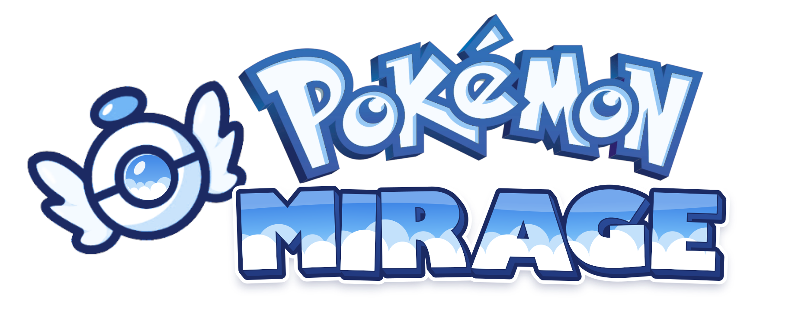

  

<h1 align="center">Pokémon Mirage</h1>

  Un fan-game Pokémon en 2D, fait avec <b>Godot 4</b> et <b>Kotlin</b>. 
  <b>Preuve de concept</b> personnelle, <b>non commerciale</b>, sans lien avec Nintendo, GAME FREAK ou The Pokémon Company.

---

## Pourquoi ce projet

Deux choses à démontrer, et rien d'autre :

- **Qu'on peut écrire un vrai jeu en Kotlin sur Godot.** Godot se programme d'ordinaire en GDScript ou en C# ; ici tout le code de production est en Kotlin compilé pour la JVM, via [godot-kotlin-jvm](https://godot-kotl.in/). L'enjeu est de voir jusqu'où ça tient : scènes, tuiles, collisions, interface, sauvegarde, données des Pokémon — en gardant le typage, l'outillage et les habitudes qu'on a en Kotlin.
- **Qu'on peut faire un jeu Pokémon sans PSDK.** PSDK et Pokémon Studio sont l'outil de référence du fan-game Pokémon, mais ils reposent sur RPG Maker XP : en pratique, ça veut dire Windows. En repartant de Godot, le même jeu s'exporte sur Windows, macOS, Linux, Android, iOS et le web. On garde leurs **données** — le pack [GameDataPacks](https://github.com/PokemonWorkshop/GameDataPacks) est la base du jeu, cf. les crédits — mais pas leur moteur.

**C'est une preuve de concept, pas un jeu qu'on promet de finir.** Le but est de montrer que ça marche ; une fois que c'est montré, le reste est du bonus. Il est donc tout à fait possible que ce projet ne soit jamais terminé, et ce ne sera pas un échec.

## Le projet

- **Moteur** : [Godot 4.7](https://godotengine.org/) avec [godot-kotlin-jvm](https://godot-kotl.in/) — les scripts sont en Kotlin.
- **Point de départ** : le tutoriel [pokemon-godot-csharp](https://github.com/joeythelantern/pokemon-godot-csharp) de The Nerdy Canuck.
- **Documentation** : [`docs/`](docs/), un fichier par sujet ; l'index est dans [`CLAUDE.md`](CLAUDE.md).

## Crédits

Rien de ce qui suit n'est de moi : merci à celles et ceux qui l'ont fait. Le détail, fichier par fichier, est dans le `CREDITS.md` de chaque dossier.

| Ce qu'on a pris | De qui | Détail |
|---|---|---|
| **Pokémon et objets** — données des espèces, textes, sprites sur la carte, icônes, cris, icônes d'objets | [GameDataPacks](https://github.com/PokemonWorkshop/GameDataPacks) de **Pokémon Workshop** (Pokémon Studio / PSDK), pack Écarlate-Violet | [`assets/pokemon`](src/main/kotlin/fr/skyle/pokemonmirage/assets/pokemon/CREDITS.md), [`assets/items`](src/main/kotlin/fr/skyle/pokemonmirage/assets/items/CREDITS.md) |
| **Personnages** | *FRLG Accurate NPC Megapack*, compilé par **SoulfulLex** — auteurs listés sprite par sprite dans son lisez-moi ; *Teraleak OWs & Assets* de **PurpleZaffre** | [`assets/characters`](src/main/kotlin/fr/skyle/pokemonmirage/assets/characters/CREDITS.md) |
| **Décors et tuiles** | planches « Pokémon Dawn » de **The-Red-eX** ; **ChaoticCherryCake**, **Phyromatical**, **TerribleJared** ; quelques planches dont l'auteur reste à retrouver | [`assets/levels`](src/main/kotlin/fr/skyle/pokemonmirage/assets/levels/CREDITS.md) |
| **Musiques** | bande-son de Pokémon HeartGold / SoulSilver (Nintendo / GAME FREAK) ; écran titre : *Pixel Fantasia* de **Lofiewme** | [`assets/audio`](src/main/kotlin/fr/skyle/pokemonmirage/assets/audio/CREDITS.md) |
| **Bruitages** | *Gen 4 Sound Effects* compilé par **Deo** ; **BellBlitzKing** ; Pokémon Essentials v21.1 | [`assets/audio`](src/main/kotlin/fr/skyle/pokemonmirage/assets/audio/CREDITS.md) |
| **Météo** | Pokémon Essentials v21.1 (**Flameguru, Poccil, Maruno** et contributeurs) | [`assets/weather`](src/main/kotlin/fr/skyle/pokemonmirage/assets/weather/CREDITS.md) |
| **Interface** | cadres de **EternalLight**, bandeaux de lieu de **torterra09**, écran du sac de Rouge Feu / Vert Feuille | [`assets/ui`](src/main/kotlin/fr/skyle/pokemonmirage/assets/ui/) |
| **Polices** | *Pokémon DP Pro* et *Pokémon Emerald Pro* de **crystalwalrein** — CC BY-SA 3.0 | [`assets/fonts`](src/main/kotlin/fr/skyle/pokemonmirage/assets/fonts/CREDITS.md) |
| **Logo** | logo Pokémon et emblème de Donjon Mystère, recolorés | [`assets/ui/title`](src/main/kotlin/fr/skyle/pokemonmirage/assets/ui/title/CREDITS.md) |

## Licences

**Pokémon** et tout ce qui s'y rattache — noms, créatures, sprites, musiques, sons — appartiennent à **Nintendo, Creatures Inc., GAME FREAK inc. et The Pokémon Company**. Ce projet n'est ni approuvé ni soutenu par eux, et n'en revendique aucun droit.

**GameDataPacks / Pokémon Studio.** Le dossier `vendor/GameDataPacks`, et tout ce que le jeu en tire, est mis à disposition par Pokémon Workshop sous la **Licence d'utilisation de Pokémon Studio** ([français](https://github.com/PokemonWorkshop/PokemonStudio/blob/develop/LICENSE-FR.md) · [English](https://github.com/PokemonWorkshop/PokemonStudio/blob/develop/LICENSE.md)) : attribution, **usage non commercial**, partage dans les mêmes conditions.

- Source : <https://github.com/PokemonWorkshop/GameDataPacks> — le pack `Gen 9/scarlet-violet` est copié dans [`vendor/GameDataPacks`](vendor/GameDataPacks/ORIGINE.md), **sans modification** ; le commit d'origine y est noté.
- Ce que le jeu en extrait est **converti** à son format (fichiers copiés, renommés ou regroupés) ; toute modification au-delà sera signalée dans le `CREDITS.md` du dossier concerné.
- Ces ressources, et les bases de données du jeu qui en reprennent le contenu, **restent sous cette même licence**. Elles sont fournies telles quelles, sans garantie, dans les limites de responsabilité prévues par la licence.
- Ce projet n'est ni lié à Pokémon Workshop, ni approuvé par lui.

**Le reste.** Chaque ressource reste la propriété de son auteur, aux conditions qu'il a posées ; elles sont rappelées dans les `CREDITS.md`. Ce dépôt ne doit servir à **aucun usage commercial**.

Vous êtes l'auteur d'une ressource utilisée ici et vous souhaitez une correction de crédit ou son retrait ? [Ouvrez une issue](https://github.com/LudoSkyle/PokemonMirage/issues).
